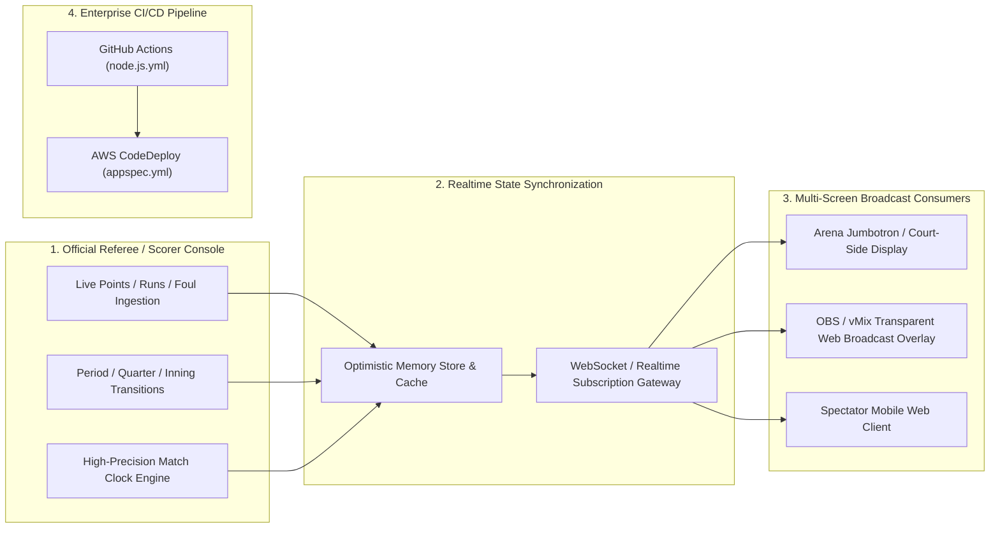

# Scoreboard Sports — Real-Time Tournament Telemetry & Live Broadcasting

[](https://react.dev/)
[](https://github.com/features/actions)
[](https://aws.amazon.com/codedeploy/)
[](https://opensource.org/licenses/MIT)

A high-frequency real-time sports scoreboard management and live streaming broadcast overlay platform. Designed for university tournaments and collegiate athletic events, Scoreboard Sports delivers sub-second score synchronizations, match state telemetry, player statistic feeds, and cloud-native CI/CD automation.

---

## 🏛️ System Architecture



---

## ⚡ Engineering Highlights

1. **Sub-Second Broadcast Overlays**:
   - Provides chromakey-compatible transparent overlays (`/overlay`) tailored for direct ingestion into broadcast software like OBS Studio, vMix, and Wirecast.
2. **Deterministic Match Clock & Timer Synchronizer**:
   - Synchronizes stopwatch countdowns across distributed client viewports via NTP drift compensation to prevent clock skew between arena displays and official scorers.
3. **AWS Enterprise Deployment Automation**:
   - Packaged with an `appspec.yml` configuration and automated GitHub Actions workflow (`.github/workflows/node.js.yml`) for automated zero-downtime rolling deployments to AWS EC2 / ECS.
4. **Resilient Local Caching**:
   - Maintains continuous match state in local storage buffers to ensure zero data loss during transient stadium Wi-Fi disconnections.

---

## 📂 Repository Structure

```text
scoreboard-sports/
├── Scoreboard-Frontend/
│   ├── .github/
│   │   └── workflows/
│   │       └── node.js.yml     # Automated build, lint, and test CI workflow
│   ├── appspec.yml             # AWS CodeDeploy deployment hook specification
│   ├── src/                    # React UI components, timers, and scoring controls
│   ├── package.json
│   └── README.md
├── DEPLOYMENT.md               # Production deployment manual for AWS infrastructure
├── .env.example                # Sample local environment configurations
├── .env.deploy.example         # Production server environment blueprint
└── README.md
```

---

## 🚀 Local Setup & Deployment

### 1. Installation
```bash
git clone https://github.com/ak-bharadwaj/scoreboard-sports.git
cd scoreboard-sports/Scoreboard-Frontend
npm install
```

### 2. Configure Environment
```bash
cp ../.env.example .env
```

### 3. Run Development Server
```bash
npm run dev
# Or npm start depending on script target
```
Navigate to [http://localhost:3000](http://localhost:3000) for the scorer console, and [http://localhost:3000/overlay](http://localhost:3000/overlay) for the OBS broadcast stream view.
